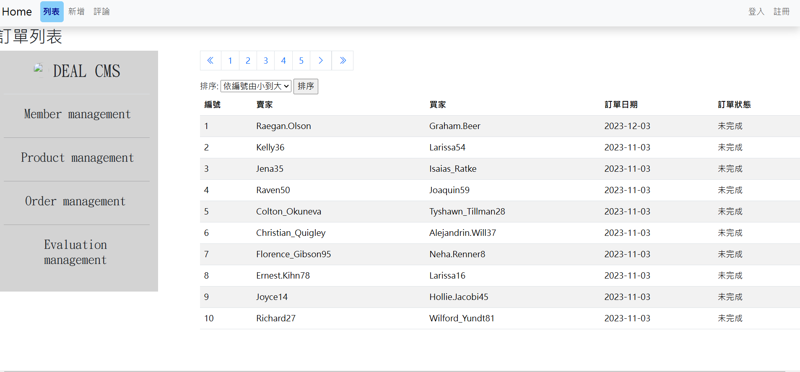
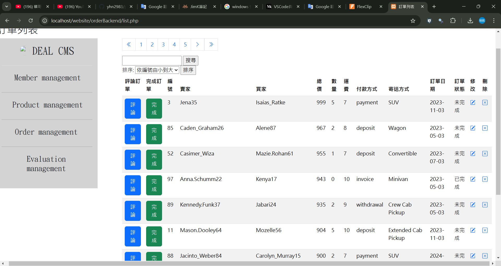

## 資策會前端工程師就業養成班期中作業  
### PHP製作網站後台  

#### 一、 基本列表呈現    
    -從資料表中選擇所有欄位。$SQL=SELECT * FROM table;  
    -透過query() 直接執行 SQL，用fetchAll()從 PDOStatement 對象中提取所有查詢結果。$rows = $pdo->query($sql)->fetchAll();  
   
1. 未登入列表畫面  

   --若無登入，則導入未登入的頁面，透過isset($_SESSION())判斷有無登入  
   
  
   
 2.登入後列表畫面    

  --若有登入，則導入登入後的頁面，透過isset($_SESSION())判斷有無登入    
    
      
  
  3.搜尋列表與排序功能    

  --透過條件判斷式來判斷以何種SQL語法讀取並排序資料庫資料  
  
  --處理搜尋功能，先透過isset($_GET["keyword"]) && $_GET["keyword"] != ""： 確保關鍵字參數存在且非空，避免處理無效查詢。  
    $keyword = "%" . $_GET["keyword"] . "%";用以模糊查詢。    
    在SQL語句中對多個欄位進行比對，並以?作佔位。  
    $stmt = $pdo->prepare($sql);以prepare() 防止 SQL 注入。  
    $stmt->bindValue(1, $keyword, PDO::PARAM_STR);用bindValue() 用來將值與 SQL 中的佔位符關聯，並指定類型為 PDO::PARAM_STR。  
    用execute() 方法執行準備好的 SQL。  
    最後透過$rows = $stmt->fetchAll(PDO::FETCH_ASSOC);取得結果。  
        
        
   4.頁碼功能    

  --定義每頁筆數：設定每頁顯示的記錄數（如 10 筆）。$perPage = 10;  
  --計算總記錄數：從資料庫查詢 order_fake 表的總筆數。$total_sql = "SELECT COUNT(1) FROM order_fake ";/$total_rows = $pdo->query($total_sql)->fetch(PDO::FETCH_NUM)[0];   
  --計算總頁數：依據總記錄數和每頁筆數，計算分頁所需的總頁數。$total_pages = ceil($total_rows / $perPage);  

  --根據選擇的頁數來決定SQL語句要取得並呈現的資料筆數。"SELECT * FROM order_fake order by id desc LIMIT %s, %s", ($page - 1) * $perPage, $perPage);  
         
    
   
  二、CRUD功能   
  1.新增    

  --定義一條 SQL 語句，用於向 product 資料表插入一條新的記錄，用"?"作為佔位符，用於防止 SQL 注入。$sql = "INSERT INTO `table`(`th1`, `th2`, `th3`, `th4` ) VALUES (?,?,?,?)";    
  --使用 PDO 的 prepare() 方法準備執行 SQL 語句。$stmt = $pdo->prepare($sql);  
  --使用 execute() 方法執行準備好的 SQL 語句，並傳入對應的值，傳入的數據將依次替換語句中的"?"。$stmt->execute([ $_POST['name1'], $_POST['name2'], $_POST['name3'],$_POST['name4'],]);   
    
     
   
  2.刪除      

--當點擊刪除鈕後，會連結到"del.php?sid=${sid}"，透過 SQL 語句"DELETE  FROM `table` WHERE id=$sid"，用於從資料表中刪除一條資料。使用 PDO 的 query() 方法執行上述 SQL 語句。
        
      
    
  3.編輯   

--$sql="UPDATE `table` SET `th_name`=?"; 定義一條SQL UPDATE語句，用於更新資料表中的記錄。     
  
--使用 PDO 的 prepare() 方法準備執行 SQL 語句，並使用 execute() 方法執行準備好的 SQL 語句。  
  
        
     
  
  三、登入登出    

--從使用者提交的表單中獲取 email 和 password 的值。使用 SQL 語句，用於從資料表中查詢與指定 email 相匹配的資料。取得資料後，使用 password_verify() 比對使用者提交的密碼和資料庫中儲存的加密密碼是否一致。若密碼一致，則將用戶的登入資訊存入 PHP 的 Session 中，供後續頁面驗證使用者身份或存取相關資料，到此完成登入功能。  
  
--若點擊登出按鈕，則刪除 PHP 的 Session 中的用戶登入資訊，以完成登出功能。  

  

## 安全性改進

以下是在 `fix/security-bugs` 分支修正的安全問題與 bug：

1. **權限控管（role）**
   - 問題：原本只檢查有沒有登入，任何人註冊後都能新增、修改、刪除資料。
   - 修正：`members` 資料表新增 `role` 欄位（`admin` / `member`，預設 `member`）；登入時把 `role` 存進 Session；`parts/admin_required.php` 改成只有 `role = 'admin'` 才能通過；列表頁也依 `role` 決定顯示管理版或一般版。
   - 既有資料庫請執行 `add_member_role.sql`。

2. **改密碼後無法登入**
   - 問題：`member_edit_api.php` 把密碼以明碼存進資料庫，登入時 `password_verify()` 比對不過。
   - 修正：改用 `password_hash()` 雜湊後再存；密碼欄位留空就不更新密碼；編輯表單與會員列表不再顯示密碼雜湊。

3. **XSS**
   - 問題：資料庫資料與使用者輸入直接輸出到 HTML。
   - 修正：列表、編輯表單的 `value`、搜尋關鍵字回填、navbar 暱稱等輸出一律用 `htmlspecialchars()` 處理；登入錯誤訊息改用 `textContent`。

4. **列表頁無限轉址**
   - 問題：資料筆數為 0 時總頁數是 0，會在 `?page=0` 和 `?page=1` 之間無限轉址。
   - 修正：總頁數至少為 1（`max(1, ceil(...))`），頁碼按鈕也不再超出實際頁數。

5. **刪除、完成訂單改用 POST + CSRF token**
   - 問題：`del.php`、`member_del.php`、`eval_del.php`、`complete_api.php` 用 GET 就能改資料，容易被惡意連結觸發。
   - 修正：新增 `parts/csrf.php` 產生 Session token；上述 API 只接受 POST 並用 `hash_equals()` 檢查 token；前端先跳確認視窗，再用 POST 表單送出；SQL 改用 `prepare()`。

6. **註冊檢查**
   - 修正：`register_api.php` 註冊前用 `filter_var()` 驗證 email 格式，並檢查 email 是否已經註冊；PDO 錯誤只寫進伺服器 log，不直接回傳給前端。

7. **API 不回傳密碼**
   - 修正：`login_api.php`、`register_api.php` 的回傳 JSON 移除 `postData`（內含密碼）；登入成功時用 `session_regenerate_id()` 更換 Session ID。

8. **搜尋結果分頁**
   - 修正：訂單搜尋結果以符合條件的筆數計算頁數，分頁連結會帶著 `keyword` 參數。

9. **移除測試檔**
   - 刪除 `test.php`、`parts/password_hash.php`。
